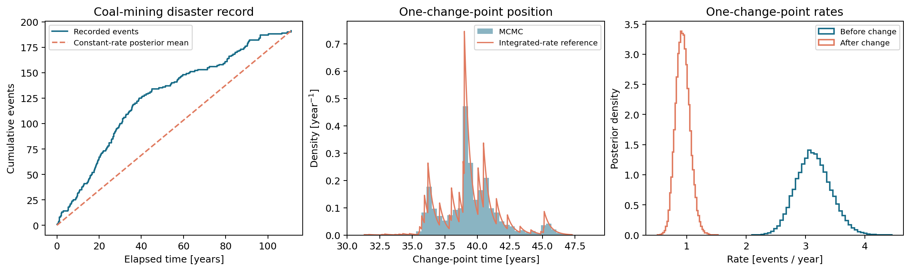
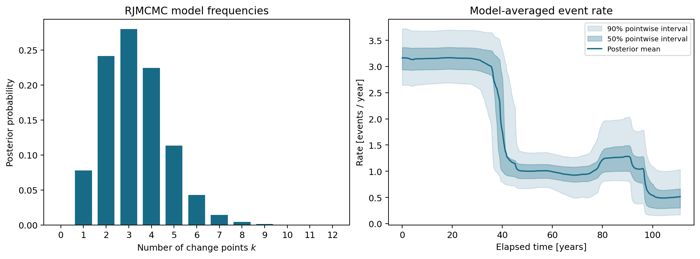

# Bayesian Change-Point Analysis of Coal-Mining Disasters

Bayesian inference for piecewise-constant event rates, from a conjugate constant-rate model to a reversible-jump sampler over an unknown number of change points.

**Peijing Pang · Cambridge MPhil in Data Intensive Science · S2 statistical methods coursework (2026)**

The analysis uses 191 recorded British coal-mining disasters to investigate changes in event rate and uncertainty in model complexity. It combines Gamma-Poisson inference, Metropolis-within-Gibbs sampling, marginal likelihoods and reversible-jump MCMC.

## Features

- Explicitly normalized priors on segment rates, ordered positions and model dimension.
- Analytic constant-rate inference and a one-change-point sampler checked against numerical integration.
- Reversible-jump height, position, birth and death moves with explicit random seeds.
- Multiple-chain diagnostics and model-averaged rates with pointwise credible intervals.
- Two notebooks, a command-line analysis and a small public dataset with documented reuse terms.

## Installation

Python **3.11+** is required. From the repository root:

```bash
python -m venv .venv
source .venv/bin/activate
python -m pip install -r requirements.txt
python -m pip install --no-deps --no-build-isolation -e .
```

## Quick start

```bash
python scripts/run_analysis.py --steps 20000 --burn 5000 --chains 2 --m1-samples 10000 --output-dir outputs/quick
```

This runs both fixed-dimension and reversible-jump inference using the bundled CSV. For the longer example shown below:

```bash
python scripts/run_analysis.py --output-dir outputs/coal
```

The default run uses four chains of 100,000 transitions, discards the first 10,000 transitions of each, and uses seed 1123. See [Running the analysis](RUNNING.md) for outputs, notebook instructions and sampling settings.

## Fixed-dimension inference



The constant-rate model has an analytic Gamma posterior. In the one-change-point model, the two rates are integrated out analytically and the remaining position integral is evaluated between event times. This provides a reference for the sampled position distribution and the model evidence.

| Quantity | Value |
| --- | ---: |
| Number of recorded events | 191 |
| Observation duration | 40,549 days |
| Constant-rate log evidence, $\log Z_0$ | -1217.087769400 |
| One-change-point log evidence, $\log Z_1$ | -1187.343876579 |
| Log Bayes factor, $\log B_{10}$ | 29.743892821 |

These model evidences use the event-time likelihood and the specified Gamma and position priors. They compare $M_0$ and $M_1$; they do not give the probability of one change point across the full model family.

## Unknown number of change points



*Four chains, 100,000 transitions per chain, 10,000 discarded transitions and seed 1123. Model frequencies use all retained draws. The rate curve uses every twentieth retained state; its bands are 50% and 90% pointwise credible intervals.*

In this run, three change points have the largest estimated model probability (about 0.280), with substantial probability at two and four change points (about 0.241 and 0.225). This supports uncertainty over the segmentation, rather than a unique change-point count.

[Run settings and diagnostics](assets/example_summary.json) accompany these figures. The model-index trace and integrated-rate trace provide scalar mixing checks, rather than a proof of convergence throughout the transdimensional state space.

The model includes the first recorded event at time zero, uses the interval sum for the observation duration, and evaluates the complete normalized prior for dimension-changing moves. See [Numerical validation](docs/numerical_checks.md) for independent checks of the likelihood, priors and samplers.

## Notebooks

| Notebook | Contents |
| --- | --- |
| [Fixed-dimension models](notebooks/01_fixed_dimension_models.ipynb) | Compare position priors, examine constant-rate inference and check the one-change-point sampler against integration. |
| [Reversible-jump inference](notebooks/02_reversible_jump.ipynb) | Inspect model probabilities, chain diagnostics and model-averaged rates. |

## Data

The 190 inter-event intervals come from the public `coal` dataset in R's `boot` package, whose stated license is **Unlimited**. The package credits Hand et al. (1994) and cites Jarrett (1979). See [Data provenance and reuse terms](docs/data.md) for attribution, export details and usage terms.

## Repository structure

```text
src/coal_changepoints/  Statistical model, samplers, diagnostics and plotting
scripts/                Analysis entry point and optional data export
data/                   Public interval CSV
notebooks/              Fixed-dimension and reversible-jump workflows
assets/                 Example figures and run summary
docs/                   Methods, numerical checks, data provenance and references
tests/                  Distributional, numerical and workflow checks
```

## Development

```bash
python -m pip install -r requirements-dev.txt
python -m pytest -q
```

Tests cover normalized priors, event boundaries, analytic evidence, split/merge inversion, the Jacobian, sampler target distributions and exported chain bookkeeping.

Scientific, software and teaching sources are listed in [References](docs/references.md).
